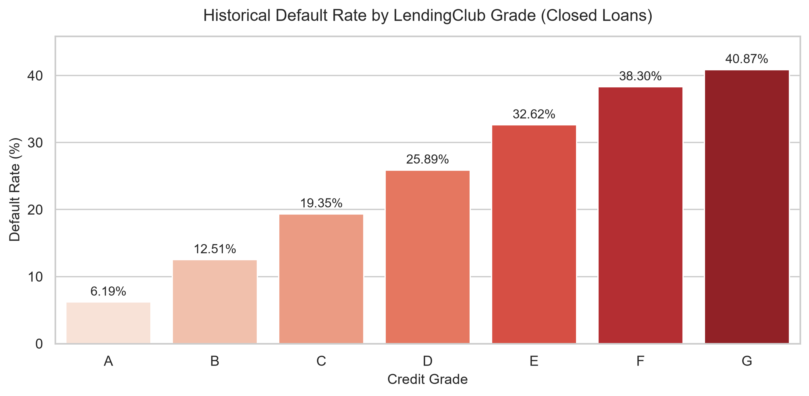
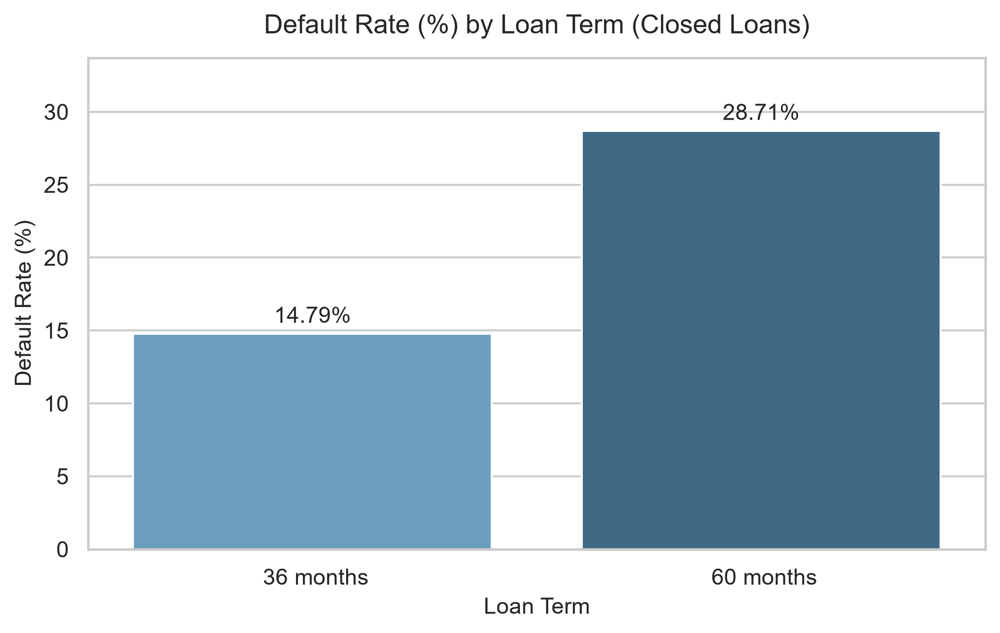
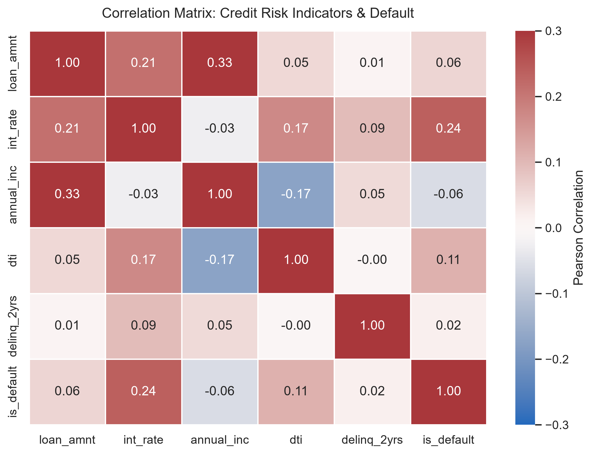
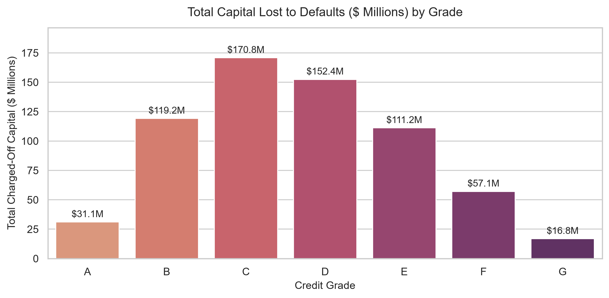

# LendingClub Credit Risk & Loan Performance Analysis

## Executive Summary
This project analyzes 887,379 LendingClub loan records to identify primary drivers of credit default, evaluate the effectiveness of risk-based pricing, and quantify portfolio capital exposure. By evaluating resolved loans (`Fully Paid` vs. `Charged Off`), this analysis quantifies empirical default multipliers, inspects borrower leverage, and highlights concentration risks across credit tiers.

---

## Key Business Insights

1. **Risk-Based Pricing Is Empirically Grounded:**
   - Default rates increase monotonically by grade: **Grade A (~6.0%)** up to **Grade G (~41.5%)**.
   - LendingClub charges an ~18% interest rate spread (7.2% for Grade A vs. 25.6% for Grade G) to absorb this **7x default frequency multiplier**.

2. **Loan Term Carries Greater Risk Than Borrower Grade:**
   - 60-month loans exhibit a **~29% default rate**, compared to **~14% for 36-month loans**.
   - A prime Grade B borrower on a 60-month schedule defaults more frequently (~18–20%) than a near-prime Grade C borrower on a disciplined 36-month schedule (~15%).

3. **Capital Exposure vs. Default Rate (The Volume Paradox):**
   - While Grade G has the highest individual default rate (~42%), it accounts for less than 2% of total capital losses due to low origination volume.
   - **Grade C generates the largest absolute dollar write-offs** because of high origination volume coupled with a moderate ~16% default rate. Underwriters must monitor Grade C exposure rather than focusing solely on lower-tier grades.

4. **Debt-to-Income (DTI) and Leverage (LTI) Escalation:**
   - Default probabilities escalate consistently as DTI exceeds 20% and reach critical levels above 30%.
   - Borrowers with Loan-to-Income (LTI) ratios exceeding 50% demonstrate substantially higher default velocity, indicating severe overextension.

---

## Analytical Visualizations

| Key Metric Analysis | Portfolio Risk View |
| :--- | :--- |
|  |  |
|  |  |

---

## Methodology & Analytics Workflow

- **Data Hygiene & Preprocessing:** Cleaned missing values in borrower income (`annual_inc`) using safe numerical methods (`np.nanmean`), resolved string formatting across loan terms, and inspected duplicate records.
- **Mitigating Censoring Bias:** Isolated resolved loans (`Fully Paid` and `Charged Off`, $N \approx 250,000$) to evaluate historical credit loss without distortion from active/in-progress loans.
- **Feature Engineering:**
  - `is_default`: Binary target indicator (1 = Default, 0 = Non-default).
  - `dti_bucket`: Discretized DTI into 4 underwriting tiers using `pd.cut()`.
  - `credit_history`: Segmented clean records vs. derogatory records (1+ prior delinquencies) via `np.where()`.
  - `lti_ratio` & `lti_tier`: Measured total loan leverage relative to annual income.
- **Exploratory Data Analysis & Visualization:** Built multi-metric aggregation matrices (`pd.pivot_table`, `.agg()`), Pearson correlation heatmaps, and categorical distributions using Seaborn and Matplotlib.

---

## Policy Recommendations for Underwriting

1. **Restrict 60-Month Originations:** Tighten eligibility for 60-month terms on Grade C and below, or enforce a lower allowable DTI ceiling (<18%).
2. **Cap Origination Volume on Grade C:** Introduce portfolio concentration caps on Grade C originations to control aggregate dollar write-offs.
3. **Hard LTI Guardrails:** Reject or manually review loan applications where the requested loan amount exceeds 40% of documented annual income, regardless of stated credit grade.
